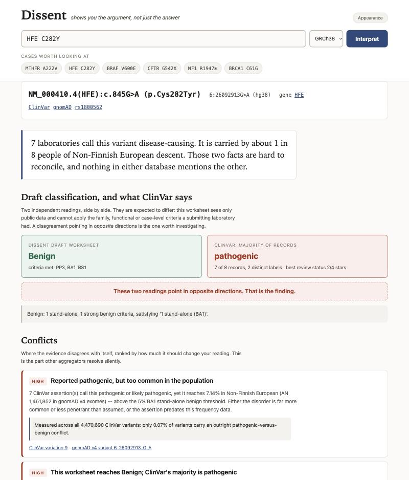
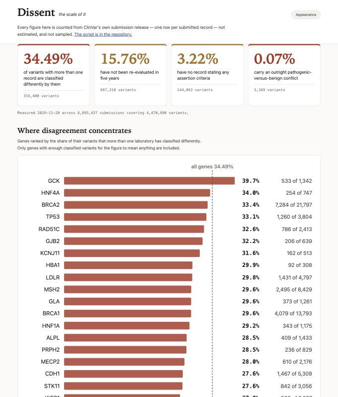
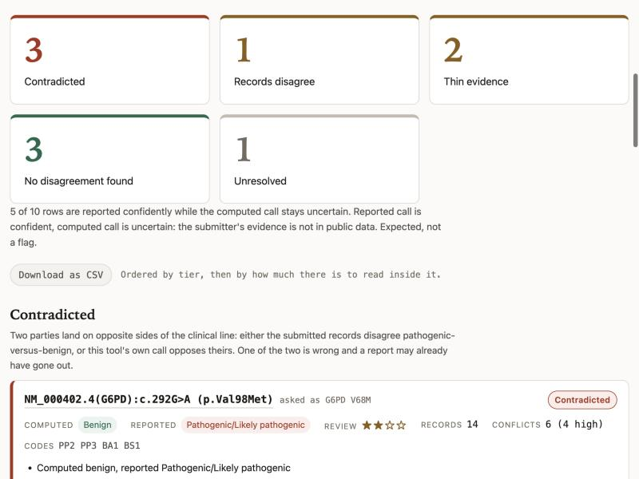

# Dissent

<!-- Once this repository exists on GitHub, paste the badge here, replacing
     OWNER/REPO with the real path:
     [](https://github.com/OWNER/REPO/actions/workflows/tests.yml)
     Until then the line below says the same thing without a broken image. -->

Tests run on Python 3.11, 3.12 and 3.13 in CI, with networking disabled
([the workflow](.github/workflows/tests.yml)).

**A variant interpretation engine that shows you the argument, not just the answer.**

Built for [GenHacks 2026](https://genhacks-open.devpost.com/).



*HFE C282Y. The worksheet reaches Benign; seven laboratories call it
pathogenic. Neither is a bug — the disagreement is the output.*

---

## The problem

Interpreting one genetic variant means opening ClinVar, gnomAD, a predictor
site, Open Targets and PubMed, then reconciling them by hand. That costs 20–60
minutes per variant.

The time is not the real problem. The reconciliation step is where errors
happen, and the tools that automate it hide exactly that step behind a single
label. Observed while building this, in real records:

- ClinVar records **contradict each other**, and the aggregate label buries it.
  Measured across the whole database: **34.5% of variants with more than one
  record are classified differently by them**, and the rate is highest in the
  genes where the answer matters most — BRCA2 33.4%, TP53 33.1%, BRCA1 29.6%.
- Many records carry `no assertion criteria provided` — an opinion with no
  stated method — rendered with the same visual weight as an expert review.
  144,092 variants have no record above that level.
- Records go **stale**. 697,310 variants have not been re-evaluated in five
  years. BRAF V600E carries one last evaluated in 2009, under a 2025 record
  that makes the whole entry look current.
- Predictors **split**. HFE C282Y: 14 call it damaging, 5 call it benign.
- **Germline criteria get applied to somatic variants**, which is a category
  error, and nothing warns you.

Those figures are measured, not estimated: see
[`analysis/clinvar_baseline.py`](analysis/clinvar_baseline.py), which streams
ClinVar's own submission release — 6,895,437 submissions across 4,470,690
variants. The whole picture is at `/scale`:



VarSome, Franklin, OpenCRAVAT and wANNOVAR aggregate well and output a label.
None of them treats *disagreement* as the primary output.

## What Dissent does

```bash
python -m dissent "HFE C282Y"
```

Four things — the first three for any variant, the fourth for a whole panel:

**1. A draft ACMG/AMP worksheet.** All 28 criteria, each with a status, the
strength applied, a one-sentence rationale, and a link to the record it rests
on. 11 are computed from public data; the other 17 say what evidence would
settle them. Nothing is omitted — a criterion that cannot be assessed is shown
as such, so an absent row is never mistaken for absence of evidence.

**2. A conflict panel.** Twelve detectors, ranked by severity, each carrying a
measured base rate so a finding can be placed rather than merely stated:

| Detector | What it catches |
|---|---|
| Record discordance | ClinVar records disagreeing, and whether within one condition or across several |
| Weak evidence base | Share of records stating no assertion criteria |
| Stale assertion | Old records sitting underneath a recent one |
| Frequency vs claim | Pathogenic records above the BA1/BS1 thresholds |
| Predictor split | Disagreement across ~20 dbNSFP predictors |
| Computed vs reported | This worksheet landing opposite ClinVar, *or* uncertain where ClinVar is confident |
| Somatic/germline misuse | Germline ACMG applied to a somatic variant |
| Internal contradiction | Pathogenic and benign criteria both met |
| Ambiguous input | An identifier covering several alleles at one position |
| Annotator disagreement | snpEff and VEP differing on the consequence |
| Unrecognised review status | A ClinVar vocabulary this build does not know |
| Unreviewed literature | Substantial literature, weak curation |

Each report also opens with one sentence that needs no vocabulary. For
HFE C282Y: *"7 laboratories call this variant disease-causing. It is carried by
about 1 in 8 people of Non-Finnish European descent. Those two facts are hard to
reconcile, and nothing in either database mentions the other."*

**3. What would change this.** For every unresolved criterion and every
conflict, the specific evidence that would settle it.

**4. A whole panel at once, at `/panel`.** A single lookup saves a reader
fifteen minutes of tab-switching; a panel changes which variants get read at
all. Paste a gene panel and every variant is interpreted against the same six
sources, then ordered into four tiers:

| Tier | What is in it |
|---|---|
| **Contradicted** | Records disagree pathogenic-versus-benign, or this worksheet lands opposite theirs |
| **Submitters split** | The records disagree with each other, but not across the clinical line |
| **Thin evidence** | Nobody disagrees, but the agreement rests on no stated criteria, one star, or an evaluation older than five years |
| **No disagreement found** | The records agree, state their criteria, and are current |



There is no score. A single number invites trust in a precision that is not
there; four named tiers, each row carrying the reasons that put it in one, can
be argued with. The tier is computed from structured fields only — ClinVar's
own labels, their review status and dates, and the computed call — never from
the wording of a conflict message. Export is CSV, so the worklist can be
annotated in a spreadsheet.

One thing deliberately **not** a tier: "computed uncertain, reported
pathogenic". It was one in the first version and swallowed 21 of 30 rows in a
test panel. That is the correct number and it makes the tier useless — a
laboratory classifies from segregation, functional assays and internal case
series, none of which is in a public API. It is a flag on the row and a count
in the summary, labelled as expected.

**And the whole database at `/scale`.** The rates above, the genes
disagreement concentrates in, and the sharpest form the measurement takes: the
**3,349 variants one laboratory calls disease-causing and another calls
harmless** — 312 of them on variants an expert panel has reviewed. Not a rate,
a list, and every row opens its own worksheet. ABCA4 c.5882G>A carries 57
pathogenic records, 15 likely pathogenic, and one benign.

## Try these

| Variant | Why it is interesting |
|---|---|
| `41815` | A ClinVar variation id. 37 laboratories call it benign and one calls it pathogenic. |
| `HFE C282Y` | Asserted pathogenic at ~7% allele frequency — above the stand-alone benign threshold. Hereditary haemochromatosis has very low penetrance, and the framework has no clean answer. |
| `MTHFR A222V` | 49% allele frequency in one population, yet 12 of 19 predictors call it damaging. BA1 and PP3 are met at once. |
| `BRAF V600E` | Somatic and germline assertions mixed in one record; 13 of 17 state no assertion criteria. |
| `CFTR G542X` | Nonsense variant in a recessive gene, where gnomAD constraint is uninformative by construction. |
| `NF1 R1947*` | PVS1 met, but the evidence falls into a gap in the published combining rules. |
| `KCNH2 A561V` | Reaches **Likely pathogenic** from public data alone. A long QT variant where rarity, the gene's intolerance of missense change, and a calibrated predictor all line up — and 64 publications sit above a ClinVar record that states no method. |
| `BRCA1 C61G` | Well curated and unanimous. Included so the conflict panel can be seen staying quiet. |

And two panels, at `/panel`:

| Panel | What it shows |
|---|---|
| Cardiomyopathy and arrhythmia (14) | Variants from a standard inherited cardiac panel. Most are reported confidently on one or two stars. |
| Carrier screening (10) | Three contradicted outright, including GJB2 V37I at three stars. One, `HBB E6V`, does not resolve — the clinical name uses legacy protein numbering and HGVS calls the same variant `p.Glu7Val`. Left in because that failure is the point. |

## Running it

Requires Python 3.11+. **No API keys, no accounts, no configuration.**

```bash
git clone <this repo> && cd dissent
python -m venv .venv && . .venv/bin/activate
pip install -e ".[dev]"
```

Web interface:

```bash
python -m dissent serve
```

Terminal:

```bash
python -m dissent "BRAF V600E"
```

JSON, for piping into something else:

```bash
python -m dissent "rs1800562" --json
```

A whole panel, as an ordered worklist or as a spreadsheet:

```bash
python -m dissent --panel my_panel.txt
```

```bash
python -m dissent --panel my_panel.txt --csv > worklist.csv
```

Tests — 411 of them, none touching the network, so they run anywhere:

```bash
python -m pytest
```

CI runs them with the socket constructor replaced, so "offline" is enforced
rather than asserted:

```bash
python -m pytest --no-network
```

Before a live demo, fill the cache so nothing waits on a public API — it
exits non-zero if any demo query would fail:

```bash
python analysis/warm_cache.py
```

### Deploying it

```bash
docker build -t dissent . && docker run -p 8000:8000 dissent
```

Nothing to configure: no API keys, no database, and the ClinVar baseline ships
in the image. `PORT` is read from the environment, so the same image runs on a
platform that assigns one. `DISSENT_CACHE_PATH` points the response cache at a
writable volume; on a read-only filesystem it turns itself off instead of
failing, and `/api/health` then says so:

```json
{"status":"ok","cache":{"enabled":false,"reason":"unable to open database file"}}
```

Verified: the image runs with `--read-only`, serves every route, and shuts
down on SIGTERM in under a second rather than waiting to be killed.

## How it works

```
dissent/
  sources/      one client per external API
  normalize/    input parsing; transcript selection from snpEff
  acmg/         one pure function per criterion, plus the combining rules
  conflicts/    one pure function per detector
  api/          FastAPI routes
  web/          single-page UI, no build step
  cache/        SQLite response cache
```

Six sources are queried concurrently in two phases, because the gene symbol is
not known until the first phase answers:

| Source | Supplies |
|---|---|
| MyVariant.info | ClinVar records, ~20 dbNSFP predictors, frequencies, snpEff annotations |
| gnomAD v4 (GraphQL) | Allele and homozygote counts, per-population frequency, gene constraint |
| Ensembl VEP | Consequence, as an independent cross-check |
| Open Targets | Gene function and disease associations |
| NCBI LitVar2 | Variant-to-publication links |
| dbSNP | Citations, carried inside the MyVariant document |

### Decisions worth stating

**Every criterion and detector is a pure function** over the evidence bundle.
No I/O, no state. That is what lets the 411 tests run offline against recorded
fixtures, and what lets a reviewer audit a rule by reading one function. The
fixtures come in two layers: normalised bundles for the scoring rules, and
verbatim API payloads for the code that produces them.

**PP3/BP4 use one calibrated predictor at its calibrated strength**
([Pejaver 2022](https://pubmed.ncbi.nlm.nih.gov/36413997/)), not a tally of
tools that happen to agree. Predictors trained on overlapping data are not
independent votes, which is why the conflict panel reports the split separately
rather than scoring it.

**PM2 is applied at Supporting**, per ClinGen SVI, not Moderate.

**BS2 is reported, never scored.** It asks whether a variant is seen in a
*healthy adult* in the genotype state the disorder requires, and public data
supplies neither inheritance mode, age of onset, nor phenotype. Scoring it from
a homozygote count inverts the answer on the clearest case: HFE c.845G>A has
3,248 gnomAD homozygotes, and homozygosity for that variant *is* what causes
hereditary haemochromatosis. It was also a second frequency criterion wearing a
genotype criterion's name — anything above 1% has homozygotes, so BS1 and BS2
fired together and two Strong criteria reached a terminal "Benign" from one row
of data.

**Frequency, cohort and allele number travel together.** Reading the frequency
from the highest-popmax record and the allele-number guard from the
largest-cohort record let an 8% estimate from 50 alleles satisfy stand-alone
BA1 while the rationale credited an 800,000-allele cohort.

**PP5 and BP6 are reported but never applied.** ClinGen retired them: using
another laboratory's conclusion as evidence double-counts the evidence they
already used.

**PVS1 is not gated on gnomAD constraint.** pLI and LOEUF measure selection
against *heterozygous* loss of function, so recessive disease genes score as
unconstrained because carriers are healthy. CFTR is pLI 3.8e-65 while loss of
function is certainly the mechanism of cystic fibrosis. Gating on constraint
would have discarded every recessive disease gene.

**Where the framework runs out, it says so** rather than inventing a rule.
Richards 2015 Table 5 has no row for one very strong criterion plus a single
supporting one — a gap created by the later PM2 downgrade. Many laboratories
do call that combination likely pathogenic; this tool reports the gap instead.

**Timeouts are a total budget per source, not per attempt.** A 20s timeout with
two retries is a 60s worst case; one slow gnomAD query consumed 63s and the
surrounding `asyncio.gather` discarded a sibling source's finished result.

**A source failure never fails the report.** The UI shows which sources
answered, which were cached, and which did not respond.

**A source failure is never reported as an empty result.** GraphQL endpoints
answer schema errors with HTTP 200 and an `errors` array. Without checking it, a
renamed gnomAD field reads as "variant not in database" — which would flip PM2
to met for every common variant while the sources panel still said `ok`. The
same applies to ClinVar review-status vocabulary: an unrecognised label is
surfaced as unknown rather than scored as zero stars.

## Limits

Stated plainly, because a tool that hides its limits is worse than one that has
them:

- **Not a clinical determination.** 17 of 28 criteria need a human.
- Frequency thresholds are **defaults**, not gene-specific. Real curation uses
  ClinGen expert-panel thresholds per gene.
- **Germline only.** Somatic variants are flagged, not classified; they belong
  under the AMP/ASCO/CAP tier system.
- Protein-notation **indels are not parsed** (`CFTR F508del` fails; its
  coordinates or rsID work).
- **Legacy protein numbering does not resolve, and cannot be guessed.** Much
  of the clinical literature numbers residues from the mature protein, while
  HGVS counts from the initiator methionine. Factor V Leiden is `R506Q` in
  print and `p.Arg534Gln` in HGVS; sickle haemoglobin is `E6V` and
  `p.Glu7Val`; the PiZ allele is `E342K` and `p.Glu366Lys`. The offset is the
  signal peptide and differs per gene, and no public endpoint here exposes a
  mapping between the two — a search by amino-acid position in dbNSFP returns
  the residue at the HGVS position, which is a different residue. So these
  inputs fail rather than resolving to a plausible wrong variant, and the
  error names the trap. Use the rsID or the c. notation. One of them,
  `HBB E6V`, is left in the demo carrier panel on purpose.
- PS1 and PM5 are marked for human review rather than computed, though the
  machinery to look them up exists.
- PVS1 runs the first branch of the Abou Tayoun 2018 decision tree only.
  Initiation-codon loss is downgraded to Moderate; the last-exon and
  NMD-escape rules need exon structure this engine does not fetch, and are
  named in the criterion rather than guessed at.
- ClinVar RCV records are variant-plus-condition aggregates, not submissions.
  Genuine submitter-level discordance lives in SCV records, which are not in
  this payload — so the per-variant panel reports record-level disagreement,
  while the database-wide base rates are computed from the SCV release.
- BA1 has no exemption list. ClinGen publishes a short list of variants that
  should not receive BA1 despite high frequency; it is not checked.
- SpliceAI is absent for many variants in the hg38 index, which leaves BP7
  unresolved more often than it should be.
- **Panel triage ranks disagreement, not clinical importance.** It says
  nothing about which variant matters most to a patient — that is a question
  about the phenotype in front of you, and no database answers it.

## Built with

Python 3.13, FastAPI, httpx, Pydantic, pytest. No front-end framework and no
build step. Charts are hand-written SVG.

Data: ClinVar, gnomAD v4, dbNSFP, dbSNP, Ensembl VEP, snpEff, Open Targets,
NCBI LitVar2, NCBI E-utilities. All public, none requiring a key.

Developed with AI assistance (Claude), as the GenHacks rules permit and require
to be disclosed. Project begun 19 November 2026, after the submission window
opened on 1 November.

## Licence

MIT.
